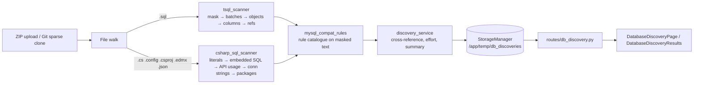
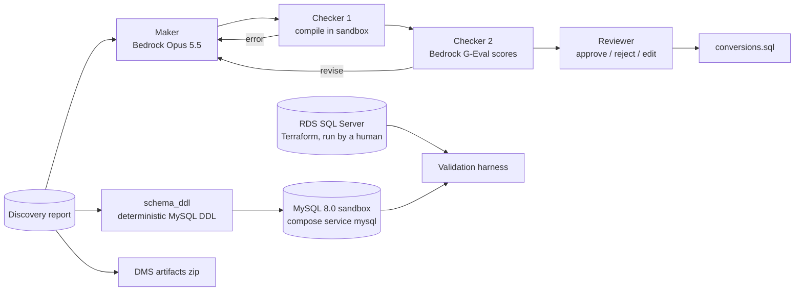

# Design Document — SQL Server → Aurora MySQL: Database Discovery

## Overview

Discovery is deterministic: no model call is made. It follows the repository's "facts, not AI
guessing" approach so that its output can later be handed to a conversion agent as grounded context.



## Components

### `backend/services/db_discovery/tsql_scanner.py`

- `read_sql_file(path)` decodes UTF-16 (BOM), UTF-8-BOM, then UTF-8 with replacement.
- `mask_tsql(text)` returns a string of identical length and line structure in which comment text and
  string-literal contents are replaced by spaces. Bracketed (`[...]`, `]]` escape) and double-quoted
  identifiers are kept. Nested `/* */` comments are handled, as T-SQL allows them.
- `split_batches(original, masked)` splits on lines matching `^\s*GO(\s+\d+)?\s*;?\s*$` in the masked
  text and returns batches with their start line.
- `find_objects(batch)` scans `CREATE [OR ALTER]` headers. Module types (procedure, function, view,
  trigger) must be the first statement in a T-SQL batch and run to its end, so scanning stops at the
  first module header. Other objects run to the next header. `CREATE TABLE #temp` is not an object.
  `ALTER DATABASE … ADD FILEGROUP` yields a filegroup; `sp_add_job @job_name = N'…'` yields a SQL
  Agent job.
- `parse_table_columns(masked_body)` splits the table body on top-level commas; constraint elements
  (`CONSTRAINT`, `PRIMARY KEY`, `FOREIGN KEY`, `UNIQUE`, `CHECK`, `INDEX`, `PERIOD FOR`) are skipped.
- `map_type_to_mysql(sql_type)` is a fixed table (see "Type mapping").
- `extract_references(masked)` matches identifiers after `FROM|JOIN|INTO|UPDATE|MERGE|EXEC|EXECUTE|REFERENCES|APPLY`.
- `sqlglot.parse_one(batch, read="tsql")` is attempted per batch, with its logger silenced. The result
  is recorded as `ast_parsed`; a parsed `Command` fallback counts as not parsed. Table names found by a
  successful parse are added to the object's references.

### `backend/services/db_discovery/mysql_compat_rules.py`

A table-driven catalogue: `Rule(id, title, category, severity, pattern, recommendation, applies_to)`.
`applies_to` restricts a rule to object types (for example `inserted`/`deleted` only in triggers;
`RETURN <value>` only in procedures). `None` means every T-SQL context, including embedded SQL.
Patterns are case-insensitive regexes over masked text. `evaluate(masked, original, base_line,
object_type)` returns `RuleHit(rule, lines[])`, de-duplicated per rule.

Categories: `data_type`, `syntax`, `procedural`, `transaction`, `feature`, `security`,
`cross_database`, `platform`, `scheduling`, `application`.

Recursive CTE detection is a function rule: for each `WITH name AS (` / `, name AS (` definition, a
reference to `name` inside its own parenthesised body marks it recursive.

### `backend/services/db_discovery/csharp_sql_scanner.py`

- `extract_string_literals(source)` is a small lexer over C#: `//` and `/* */` comments, char literals,
  `"…"`, `@"…"`, `$"…"`, `$@"…"`/`@$"…"`, and `"""…"""`. Interpolation holes become `{?}`. Runs of
  literals separated only by `+` merge into one literal flagged `concatenated`.
- `looks_like_sql(text)` requires a leading SQL verb plus a second structural keyword (`SELECT … FROM`,
  `INSERT … INTO|VALUES`, `UPDATE … SET`, `DELETE … FROM|WHERE`, `MERGE … USING`, `EXEC <name>`, `WITH … AS (`).
- Code-level API rules (category `application`) run on comment-stripped C#.
- Stored-procedure calls: a literal that names a known procedure (`Schema.Name`, `[Schema].[Name]`,
  or an unambiguous bare `Name`), alone or after `EXEC`. Also, a literal within five lines of
  `CommandType.StoredProcedure` that looks like a qualified identifier is recorded, resolved or not.
- Connection strings: matched in `.config`, `.json`, and `.cs`. `Password=`/`Pwd=` values are replaced
  by `***` before anything is stored.
- Packages: `<PackageReference Include=… Version=…>`, `packages.config <package id=… version=…>`,
  `<Reference Include="EntityFramework, Version=…">`, and `<TargetFrameworkVersion>`/`<TargetFramework>`.
- `.edmx`: SSDL `Provider="System.Data.SqlClient"` and `ProviderManifestToken`.

### `backend/services/db_discovery/discovery_service.py`

`DatabaseDiscoveryService.run(root, discovery_id, source_type, source_url, branch)` walks the tree
(skipping `.git`, `bin`, `obj`, `node_modules`, `packages`), runs both scanners, cross-references
procedure calls into `objects[].called_from_code`, computes effort and summary, and saves.

Effort formula (shown in the UI and report):

```
points = Σ over distinct rules hit on the object of weight(severity)
         + lines_of_code / 100
weight: blocker 13, high 5, medium 2, low 0.5, info 0
bucket: points < 2 → low; < 8 → medium; < 20 → high; else very_high
an object with any blocker finding is at least high
```

### `backend/routes/db_discovery.py`

| Method | Path | Response |
|---|---|---|
| POST | `/api/db-discovery/upload` | `{"discovery_id", "status", "message"}` |
| POST | `/api/db-discovery/github` | `{"discovery_id", "status", "message"}` — body `{repo_url, branch, pat_token, subpath}` |
| GET | `/api/db-discovery/{id}/status` | `{"discovery_id", "status", "progress", "current_step", "message"}` |
| GET | `/api/db-discovery/{id}` | full report (top-level object) |
| GET | `/api/db-discovery/{id}/report.md` | `text/markdown` attachment |
| GET | `/api/db-discoveries` | `{"discoveries": [...]}` |
| DELETE | `/api/db-discovery/{id}` | `{"detail": "Deleted"}` |
| GET | `/api/db-discovery/rules` | `{"rules": [...]}` |

Discovery IDs follow the repo convention `{source}_{YYYYMMDD_HHMMSS}` with source `dbupload` or
`dbgithub`. Storage is a second `StorageManager` rooted at `/app/temp/db_discoveries`
(`app_state.db_discovery_storage`), so code-analysis listings are unaffected. Progress uses the
shared `ProgressTracker`. The background task is a plain `def` (threadpool), matching `routes/analysis.py`.

`GitHubHandler.clone` gains an optional `sparse_paths` argument (`--filter=blob:none --sparse` then
`git sparse-checkout set`). Existing callers are unchanged. The discovery clone is removed after the run.

## Report schema (abridged)

```json
{
  "discovery_id": "dbgithub_20261103_120000",
  "source_type": "github", "source_url": "...", "branch": "master", "subpath": "...",
  "completed_at": "2026-11-03T12:00:05Z",
  "target": "Aurora MySQL 3 (MySQL 8.0)",
  "summary": { "files_scanned": {...}, "object_counts": {...}, "finding_counts": {...},
               "category_counts": {...}, "effort_counts": {...}, "top_rules": [...],
               "schemas": [...], "total_sql_lines": 0, "ast_parse": {"batches": 0, "parsed": 0},
               "application": {...}, "effort_formula": "..." },
  "objects":  [{ "id", "schema", "name", "type", "subtype", "file", "line", "lines_of_code",
                 "parent", "columns", "references", "referenced_by", "called_from_code",
                 "finding_counts", "effort", "effort_points", "ast_parsed" }],
  "findings": [{ "id", "rule_id", "title", "category", "severity", "source", "object_id",
                 "file", "line", "occurrences", "lines", "snippet", "recommendation" }],
  "type_mappings": [{ "sql_server_type", "mysql_type", "note", "column_count" }],
  "application": { "files", "embedded_sql", "stored_procedure_calls", "connection_strings",
                   "packages", "target_frameworks", "technologies" }
}
```

## Type mapping (SQL Server → MySQL 8.0)

| SQL Server | MySQL | Note |
|---|---|---|
| bigint / int / smallint | BIGINT / INT / SMALLINT | |
| tinyint | TINYINT UNSIGNED | SQL Server tinyint is 0–255 |
| bit | TINYINT(1) | |
| decimal(p,s) / numeric(p,s) | DECIMAL(p,s) | |
| money / smallmoney | DECIMAL(19,4) / DECIMAL(10,4) | |
| float(n≤24) / real | FLOAT | |
| float / float(n>24) | DOUBLE | |
| date | DATE | |
| time(n) | TIME(min(n,6)) | precision capped at 6 |
| datetime | DATETIME(3) | |
| datetime2(n) | DATETIME(min(n,6)) | precision 7 → 6 |
| smalldatetime | DATETIME | |
| datetimeoffset(n) | DATETIME(6) | offset lost: store UTC plus an offset column |
| char/nchar(n) | CHAR(n) | utf8mb4 for nchar |
| varchar/nvarchar(n) | VARCHAR(n) | utf8mb4 for nvarchar; check 65,535-byte row limit |
| varchar/nvarchar(max), text, ntext | LONGTEXT | cannot be fully indexed |
| binary(n) / varbinary(n) | BINARY(n) / VARBINARY(n) | |
| varbinary(max), image | LONGBLOB | |
| uniqueidentifier | CHAR(36) | or BINARY(16) with UUID_TO_BIN |
| xml | LONGTEXT | no XML type or XQuery methods |
| geography / geometry | GEOMETRY (SRID 4326 for geography) | spatial functions differ |
| hierarchyid | VARCHAR(4000) | no equivalent; materialised path or closure table |
| sql_variant | — | no equivalent; redesign |
| rowversion / timestamp | BIGINT UNSIGNED / TIMESTAMP(6) ON UPDATE | no automatic row version |
| sysname | VARCHAR(128) | |
| user-defined alias type | base type resolved when defined in the scripts | |

## Security

- ZIP extraction uses `utils/zip_safety.safe_extract` (zip-slip and size cap).
- Upload file names are reduced to their basename and confined to the temp directory.
- `subpath` is validated (Requirement 1.3) and the resolved root must stay inside the clone.
- Connection-string passwords are redacted before storage.
- Discovery IDs are validated with the repo's `^[A-Za-z0-9_-]+$` rule.
- File reads are capped at 5 MB per file; larger files are counted as skipped.

## Testing

- Unit tests per scanner with focused T-SQL and C# snippets: masking, batches, object detection,
  columns, type mapping, each rule family, literal extraction, procedure-call resolution, redaction.
- Route tests with `TestClient`: upload → status → report → markdown → list → delete, and
  `subpath` validation.
- An end-to-end test runs the service on `samples/wwi-legacy-dotnet` plus T-SQL fixtures.
- Frontend vitest for the start page and results page with a mocked API.
- Deployed acceptance: `docker compose up -d --build`, a discovery of the WideWorldImporters SSDT
  sub-path from GitHub, and a ZIP upload of the demo archive, both checked through nginx on port 3000.

---

# Phase 2: Conversion, Validation, DMS Artifacts



## Components

| Module | Responsibility |
|---|---|
| `backend/services/db_conversion/schema_ddl.py` | Report → MySQL DDL (Requirement 8). Primary keys come from a `primary_key` list the T-SQL scanner now records per table. |
| `backend/services/db_conversion/mysql_sandbox.py` | PyMySQL connection to the sandbox; loads the schema for a discovery (once per discovery, under a process lock); compiles one statement (`DROP … IF EXISTS` then the `CREATE`) and returns the MySQL error number and message. |
| `backend/services/db_conversion/conversion_agent.py` | Maker/Checker loop; JSON extraction from model output; attempt history. |
| `backend/services/db_conversion/conversion_store.py` | One JSON document per discovery under `/app/temp/db_conversions`, updated under a lock. |
| `backend/routes/db_conversion.py` | Conversion, schema and DMS-artifact endpoints. |
| `backend/services/db_validation/` | `connections.py` (env-configured, password-free descriptions), `normalize.py`, `harness.py`. |
| `backend/routes/db_validation.py` | Validation endpoints. |
| `backend/services/db_dms/artifacts.py` | DMS artifact generation (Requirement 12). |
| `backend/prompts/sql-conversion-maker.md`, `sql-conversion-checker.md` | Prompt templates, loaded through `services/prompt_loader`. |
| `infra/terraform/rds-sqlserver-test/` | Requirement 11. |

## Schema mapping decision

A SQL Server schema maps to a MySQL database with the same name (`Sales.Orders` → `` `Sales`.`Orders` ``).
Qualified references in converted code therefore keep their shape. This is the AWS DMS / Schema
Conversion default for SQL Server → MySQL. Identifier case is preserved; Aurora MySQL's default
`lower_case_table_names=0` makes names case-sensitive, so the Maker is told to keep exact case.

## Conversion record

```json
{
  "object_id": "procedure:website.searchforcustomers",
  "object_type": "procedure",
  "status": "queued | converting | converted | needs_review | failed | approved | rejected",
  "attempts": [
    {"n": 1, "sql": "CREATE PROCEDURE …", "notes": "…",
     "compile": {"ok": false, "errno": 1064, "message": "…"},
     "judge": {"scores": {"semantic_equivalence": 4, "...": 5}, "verdict": "revise", "issues": ["…"]},
     "passed": false}
  ],
  "final_sql": "…", "reviewer_note": "", "edited": false, "error": "", "updated_at": "…"
}
```

`converted` means the last attempt passed both checkers; `needs_review` means attempts were exhausted
with the best attempt kept as `final_sql`; `failed` means no SQL was produced (Bedrock or sandbox outage).

## Sandbox compile semantics

MySQL validates syntax but not table existence when it creates a procedure or function, and it resolves
tables when it creates a view or trigger. Loading the schema DDL first therefore makes the compile check
meaningful for all four object types. Row-size errors (1118) on table creation are retried with
`VARCHAR(n ≥ 1000)` widened to `TEXT`.

## Validation normalisation

Values are normalised client-side before hashing so both engines produce the same digest:
`None → "∅"`; booleans and `bit` → `0/1`; `Decimal` → fixed-point string with trailing zeros removed;
`datetime` → ISO 8601 truncated to microseconds; `bytes` → hex; strings with trailing spaces trimmed
(SQL Server compares `char` padded); JSON text is canonicalised; UUID strings are lower-cased.
A table checksum is the sum, modulo 2^128, of per-row SHA-256 digests (truncated to 128 bits), so row
order does not matter and, unlike XOR, duplicate rows do not cancel out; row counts are compared too.

## Compose and configuration

- New service `mysql` (`mysql:8.0`, linux/arm64, backend-net only, healthcheck, named volume,
  127.0.0.1-only port 3307). Credentials come from `.env` (`MYSQL_ROOT_PASSWORD`).
- New backend settings: `MYSQL_SANDBOX_HOST/PORT/USER/PASSWORD`, `CONVERSION_MAX_ATTEMPTS`,
  `VALIDATION_SQLSERVER_HOST/PORT/USER/PASSWORD/DATABASE`, `VALIDATION_MYSQL_*` (default to the sandbox),
  `VALIDATION_ALLOW_COPY`.
- New Python dependencies: `PyMySQL`, `pymssql` (aarch64 manylinux wheels bundle FreeTDS).
